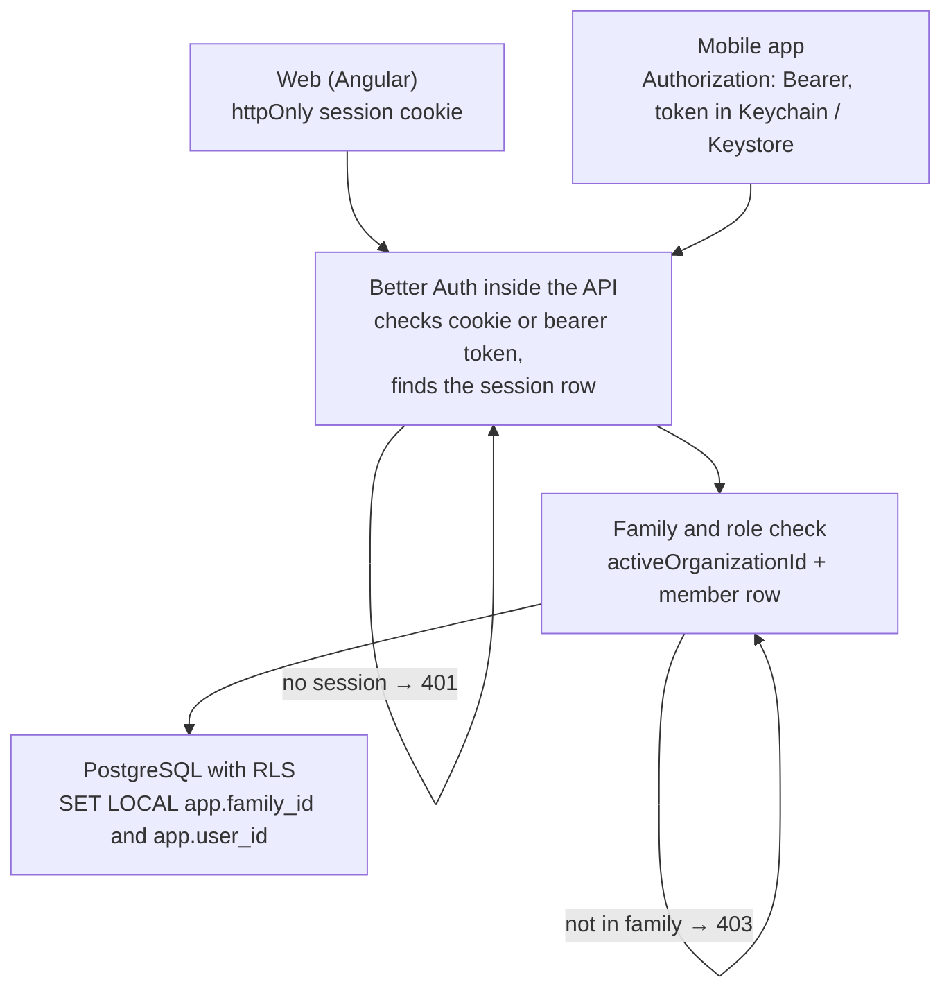

# Authentication with Better Auth

November 21, 2026.

**Product: Swarm Keeper** — a family archive for photos and documents.

## Decision

Authentication is handled by the Better Auth library inside the API process (the `identity` module), with no separate OIDC provider. Users, sessions and families live in the same PostgreSQL database as the archive data.

**Why:**

- One service fewer: no IdP container, no extra database or admin console.
- Everything needed already exists as plugins: passkeys, 2FA, organizations with invitations and roles.
- TypeScript-native: session and client types are inferred from a single config.

**What it costs:**

- The sign-in code runs in our process, so prompt updates are our job.
- Security depends heavily on configuration: the defaults are not designed for a closed family app.
- Single sign-on into other apps (Immich, Nextcloud) would require turning Better Auth into an OAuth provider. Not needed for now.

## Request flow

Web and mobile clients arrive at the same session and the same family check.



Every API request passes three gates: the session, family membership with the role's permissions, and RLS in the database. Even if a service forgets a check, another family's data stays invisible.

## Model: family = organization

The source of truth for families and their members is the Better Auth organization plugin. There are no `family` or `membership` tables of our own, so there are no two models to keep in sync. `family_id` in archive tables is `organization.id`.

An installation can host several families, and a person can belong to more than one (for example, their parents' family and their spouse's). The active family is picked with the switcher in the header and stored in `session.activeOrganizationId`. New families are created only by the installation administrator, with a server-side script.

| Table | Source | Role in the archive |
| --- | --- | --- |
| `user` | Better Auth core | Account of a person who signs in |
| `session` | Better Auth core | Sessions; `activeOrganizationId` is the current family |
| `account` | Better Auth core | Sign-in methods: password, OAuth |
| `verification` | Better Auth core | Email verification and password reset tokens |
| `passkey`, `twoFactor` | passkey and twoFactor plugins | WebAuthn keys and TOTP secrets |
| `organization` | organization plugin | Family |
| `member` | organization plugin | Family member and their role |
| `invitation` | organization plugin | Email invitation with a role and an expiry |

Links to archive tables:

- `asset.family_id`, `album.family_id`, etc. → `organization.id`.
- `asset.owner_id` → `user.id`.
- `person.user_id` → `user.id`, optional: grandma can be a `person` without an account.

Better Auth tables are generated by its CLI (`npx auth generate`; the `auth` package replaced `@better-auth/cli` after 1.4) but applied by our migrations along with the rest of the schema, so the whole schema history lives in one place.

- **Names are snake_case**, like the rest of the database: `apps/api/src/modules/identity/snake-case-schema.ts` maps every model and field through `modelName` / `fields`, computed from Better Auth's own table list. `database.casing: "snake"` exists in the 1.7.27 types but has no effect; when a release makes it work, replace the mapping with it.
- **IDs are UUIDv7:** `advanced.database.generateId: "uuid"` lets Postgres generate them, and our migration defaults every `id` to `uuidv7()`.
- **Telemetry is off** (`telemetry: { enabled: false }`).

## Sign-up and sign-in methods

Sign-up is by invitation only. The primary sign-in method is a passkey; a password with a verified email is the fallback.

**How a new member joins:**

1. The first owner and family are created once by a seed script at deployment.
2. An owner or admin invites a person by email with a role; the email contains a link.
3. The invitee opens the link (`/invite/:token`, which reads `GET /api/v1/invitations/:id` without a session) and creates an account for the invited email address, with a passkey (primary) or a password (fallback). Following the link counts as email verification: the account is created with `emailVerified: true` only for a pending invitation whose email matches. There is no second email.
   - **Passkey, no password.** The passkey plugin runs with `registration.requireSession: false`. The client sends `context` = `{ invitation, name, locale }`. `resolveUser` checks that the invitation is pending and that its email has no account. `afterVerification` runs inside Better Auth's registration transaction (`createSession: true`; transactions are on: `database.transaction: true`): it creates the user through the internal adapter, so the user hooks run, inserts the membership and marks the invitation accepted. If storing the passkey or the session fails, all of it rolls back. A signed-in user may add a passkey only from a fresh session (younger than `freshAge`, 1 day): `requireSession: false` drops the plugin's own fresh-session check, so `afterVerification` keeps it (`SESSION_NOT_FRESH`). Then the plugin signs in. No `credential` account exists, so the 2FA rule for owners and admins does not apply. Code: `apps/api/src/modules/identity/passkey-sign-up.ts`.
   - **Password.** `/sign-up/email` with `inviteToken`; the `user.create` hooks check the token and add the membership.
   - **Language.** Both paths take the visitor's last choice (`locale`, `en` or `ru`) over `invitation.locale`.
   - **Existing account.** Someone who already has an account signs in and accepts with `/organization/accept-invitation`.
4. The invitation is accepted right after the account is created, and the person becomes a family member. The token travels as `inviteToken` in the sign-up request body. Sign-up does not start a session (email verification is required by configuration), so the client signs in right after it.
5. We immediately offer to add a passkey.

Sign-up without an invitation is rejected by the `user.create.before` hook: if there is no valid invitation for the email, no record is created (error code `INVITE_REQUIRED`, HTTP 400). It is not a 403: with `requireEmailVerification`, Better Auth 1.7 turns a 403 from user creation into a fake success response to hide which emails exist, and the client would never see the code. Regular users cannot create new families.

| Method | For whom | Status |
| --- | --- | --- |
| Passkey (fingerprint, Face ID, PIN) | Everyone; the simplest option for elderly relatives | v1 |
| Email + password, with mandatory email verification | Fallback sign-in and account recovery | v1 |
| 2FA (TOTP + backup codes) | Mandatory for owners and admins who sign in with a password | v1 |
| Magic link / email code | Relatives without a passkey-capable device | Later, on request |
| Sign in with Google / Apple | — | Not enabled: unnecessary attack surface (see "Operations and security") |

**Email language.** Every email template exists in English and Russian. The invitation goes out in the language the admin picked (`invitation.locale`, defaulting to the admin's own); the `/invite/:token` page opens in that language, and on sign-up it is saved to `user.locale`. Email verification, password reset and all other emails use `user.locale`: `mailer` picks the template by the recipient's language. The texts live in `apps/api/src/modules/identity/mail/i18n/{en,ru}.json` and use the design-system glossary; each email is HTML plus `text/plain`.

**Email delivery.** The API sends over SMTP (`SMTP_URL`, `MAIL_FROM`; module `apps/api/src/modules/mail`), so any provider with SMTP fits; which one runs in production is still open. In development every email lands in Mailpit (`compose.yaml`, web UI at http://127.0.0.1:8025). Verification and reset emails are sent without awaiting SMTP, so the response time does not reveal whether an account exists. Better Auth 1.7.27 catches a failed invitation send and only logs it: the invitation is still created and `invite-member` answers 200, so the admin UI (step 6) must offer "resend".

**Account recovery.** Forgot the password — reset by email. Owners and admins with 2FA who lost their phone sign in with backup codes. With access to neither the passkey nor the mailbox, an admin or owner sends a recovery link to a new address: the account's email changes, old passkeys and sessions are revoked, files and role are kept, and the event goes to the activity log. If the only owner loses access, recovery is done with a server-side script, like the initial setup.

## Roles and permissions

The plugin has owner, admin and member roles. We add a viewer role and our own resources (`asset`, `album`, `archive`) via `createAccessControl`, so all checks go through one mechanism.

| Action | owner | admin | member | viewer |
| --- | --- | --- | --- | --- |
| View the family's shared photos and documents | yes | yes | yes | yes |
| Upload, create albums | yes | yes | yes | no |
| Edit and delete own items | yes | yes | yes | no |
| Edit and delete others' shared items | yes | yes | no | no |
| Invite and remove members, change roles | yes | yes | no | no |
| Empty the trash, export the archive | yes | yes | no | no |
| Delete the family, transfer ownership | yes | no | no | no |
| Mark own favorites | yes | yes | yes | yes |

Private files (`visibility = private`) are visible only to their author, regardless of role. Our service layer and RLS enforce this, not Better Auth. The viewer role suits distant relatives and children. When a member is removed from the family, their shared files stay with the family and their private files are deleted after 30 days (see [backend.md](backend.md), section 6).

## Integration with NestJS, Angular and the mobile client

The web app uses an httpOnly cookie, the mobile app a bearer token. Both lead to the same row in `session`.

**NestJS (API).**

- Integration via `@thallesp/nestjs-better-auth`, community-maintained. The adapter is Express: Fastify support is still in beta.
- `AuthModule.forRoot({ auth })` mounts the `/api/auth/*` routes and enables a global guard: everything is closed by default, and public routes are marked with `@AllowAnonymous()`.
- Controllers get the session via `@Session()`. Our own `@RequirePermission('asset', 'delete')` decorator calls the organization plugin's role check.
- The dependency on the third-party wrapper is thin: if it lags behind Better Auth releases, it can be replaced with our own guard on `auth.api.getSession()`.

**Angular (web).**

- The API and the frontend are served from the same domain via Caddy, so cookies work without CORS and with `SameSite=Lax`.
- `createAuthClient` from `better-auth/client` (framework-agnostic) is wrapped in an `AuthService` with signals for the session and the active family.
- The token never reaches JavaScript and is never stored in localStorage.

**Mobile app.**

- Bearer plugin: after sign-in the session token arrives in the `set-auth-token` header and is then sent as `Authorization: Bearer`.
- The token is stored in the Keychain (iOS) or Keystore (Android), not in regular app storage.
- Background auto-upload uses the same token, so the session must be extended on activity (see "Configuration").

**Passing the family to RLS.** For each request the API takes `activeOrganizationId` from the session, checks that the user is in `member` for that family, and opens a transaction with `SET LOCAL app.family_id` and `SET LOCAL app.user_id`. RLS policies on archive tables filter by these values. Workers run under a separate database role and set `family_id` from the job.

## Configuration

The defaults are designed for open SaaS, so here is what we must change.

- [ ] `baseURL` and `BETTER_AUTH_SECRET` are set explicitly via environment variables; the secret is not in the repository.
- [ ] `emailAndPassword.requireEmailVerification: true` (off by default).
- [ ] Sign-up by invitation only: the `user.create.before` hook.
- [ ] `allowUserToCreateOrganization: false`.
- [ ] Only the plugins we need: organization, passkey, twoFactor, bearer.
- [ ] Rate limiting stored in the database (not in memory), client IP taken from `x-forwarded-for`. Better Auth reads the IP only from that header, never from the socket, so: the API listens on `127.0.0.1` (`HOST`) and only the reverse proxy reaches it; the proxy overwrites the header with the client address, or lists itself in `TRUSTED_PROXIES` if it appends. A spoofable header would let a client pick a fresh rate-limit bucket per request.
- [ ] Auth settings fail closed: dev defaults apply only with `NODE_ENV` set to `development` or `test`; otherwise `BETTER_AUTH_SECRET` (≥ 32 characters, never the dev value), `BETTER_AUTH_URL` and `PASSKEY_RP_ID` are required. Secure cookies follow the `https` scheme of `BETTER_AUTH_URL`.
- [ ] 30-day sessions, extended once a day on activity; `cookieCache` stays off until load requires it.
- [ ] Secure cookies and HTTPS in production.
- [ ] Mandatory 2FA for owners and admins with a password, decided by account, not by session: Better Auth does not record how a session was opened, and while a password exists it is the weak link. An owner or admin who has a password (`credential` account) and no 2FA gets `TWO_FACTOR_REQUIRED` (403) on every admin action; a passkey-only account is exempt; members are never asked. Admin actions are derived from the roles (allowed for owner or admin, not for member). The rule runs in two places with one check: `@RequirePermission(resource, action)` on our routes, and a `hooks.before` on Better Auth's `/organization/invite-member`, `update-member-role`, `remove-member`, `cancel-invitation`, `update` and `delete`. The hook resolves the caller through `auth.api.getSession`, because user hooks run before the bearer plugin and would not see mobile sessions. On those Better Auth routes the rule applies to anyone who is an owner or admin in any family, without guessing which family the request targets: Better Auth falls back from an empty `organizationId` to the active family and ignores the field on `cancel-invitation`, so matching its resolution would be a bypass waiting to happen.
- [ ] Nobody deletes their last way to sign in: deleting the only passkey of an account with no password answers `LAST_SIGN_IN_METHOD` (400). A `hooks.before` on `/passkey/delete-passkey` checks it (`apps/api/src/modules/identity/security-hooks.ts`). The check and the delete are not atomic; two simultaneous deletes of the last two passkeys could both pass, which is accepted (recovery: an admin recovery link or the server script).
- [ ] Adding a passkey needs a fresh session (younger than `freshAge`, 1 day). The same hooks module refuses `/passkey/generate-register-options` from a stale session with `SESSION_NOT_FRESH` before the browser prompt, so the device never keeps a passkey the server did not store; `afterVerification` keeps the check as a backstop.
- [ ] One role per member: invitations and role changes take exactly one of owner / admin / member / viewer, otherwise `SINGLE_ROLE_REQUIRED` (400). Only an owner grants the owner role (Better Auth's `creatorRole`, kept at its default).
- [ ] A new session starts in the user's first family (by join date) when none is active. `GET /api/v1/me` returns the user (`locale`, `uiSize`, `twoFactorEnabled`), their families with roles, `activeFamilyId`, the active `role`, its `permissions` (`resource:action`) and `twoFactorRequired`.
- [ ] Errors are codes without text: our own (`INVITE_REQUIRED`, `TWO_FACTOR_REQUIRED`, `SINGLE_ROLE_REQUIRED`, `NAME_REQUIRED`, `NAME_TOO_LONG`, `SESSION_NOT_FRESH`, `LAST_SIGN_IN_METHOD`) and Better Auth's; the client shows English or Russian text. Better Auth's routes answer `{ code, message }`: the client reads only `code` and ignores `message`.

`auth.ts` skeleton (check option names against the docs of the exact version when installing):

```ts
import { betterAuth } from "better-auth";
import { APIError } from "better-auth/api";
import { organization, twoFactor, bearer } from "better-auth/plugins";
import { passkey } from "@better-auth/passkey";
import { Pool } from "pg";
import { ac, roles } from "./permissions";
import { findPendingInvitation } from "./invitations";
import { mailer } from "./mailer";

export const auth = betterAuth({
  appName: "Swarm Keeper",
  baseURL: process.env.BETTER_AUTH_URL,
  database: new Pool({ connectionString: process.env.DATABASE_URL }),

  user: {
    additionalFields: {
      locale: { type: "string", defaultValue: "en" },      // "en" | "ru"
      uiSize: { type: "string", defaultValue: "compact" }, // "compact" | "large"
    },
  },

  emailAndPassword: {
    enabled: true,
    requireEmailVerification: true,
    minPasswordLength: 12,
    sendResetPassword: ({ user, url }) => mailer.resetPassword({ email: user.email, url, locale: user.locale }),
  },
  emailVerification: {
    sendOnSignUp: false, // on sign-up, the invitation link verifies the email
    autoSignInAfterVerification: true,
    sendVerificationEmail: ({ user, url }) => mailer.verifyEmail({ email: user.email, url, locale: user.locale }),
  },

  session: {
    expiresIn: 60 * 60 * 24 * 30, // 30 days
    updateAge: 60 * 60 * 24,      // extend once a day
  },

  rateLimit: { enabled: true, storage: "database" },
  advanced: {
    useSecureCookies: process.env.NODE_ENV === "production",
    ipAddress: { ipAddressHeaders: ["x-forwarded-for"] },
  },

  databaseHooks: {
    user: {
      create: {
        before: async (user, ctx) => {
          // the invitation token arrives in the sign-up request body
          const invite = await findPendingInvitation(user.email, ctx?.body?.inviteToken);
          if (!invite) {
            throw new APIError("BAD_REQUEST", { code: "INVITE_REQUIRED" }); // not FORBIDDEN, see above
          }
          // a link mailed to this address proves ownership of it
          return {
            data: { ...user, emailVerified: true, locale: invite.locale, uiSize: invite.uiSize },
          };
        },
      },
    },
  },

  plugins: [
    organization({
      ac,
      roles,
      allowUserToCreateOrganization: false,
      invitationExpiresIn: 60 * 60 * 24 * 7, // 7 days
      schema: {
        invitation: {
          additionalFields: {
            locale: { type: "string" },
            uiSize: { type: "string" },
          },
        },
      },
      sendInvitationEmail: (data) => mailer.invitation(data), // + inviter name, family name, expiry, invitation.locale
    }),
    passkey({
      rpID: process.env.PASSKEY_RP_ID,   // the app's domain
      rpName: "Swarm Keeper",
      origin: process.env.BETTER_AUTH_URL,
    }),
    twoFactor({ issuer: "Swarm Keeper" }),
    bearer(),
  ],
});
```

Roles and resources (`permissions.ts`):

```ts
import { createAccessControl } from "better-auth/plugins/access";
import { defaultStatements, ownerAc, adminAc, memberAc } from "better-auth/plugins/organization/access";

const statement = {
  ...defaultStatements,
  asset: ["read", "create", "update", "delete", "manage"],
  album: ["read", "create", "update", "delete", "manage"],
  archive: ["export", "purge-trash"],
} as const;

export const ac = createAccessControl(statement);

export const roles = {
  owner: ac.newRole({ ...ownerAc.statements, asset: [...statement.asset], album: [...statement.album], archive: ["export", "purge-trash"] }),
  admin: ac.newRole({ ...adminAc.statements, asset: [...statement.asset], album: [...statement.album], archive: ["export", "purge-trash"] }),
  member: ac.newRole({ ...memberAc.statements, asset: ["read", "create", "update", "delete"], album: ["read", "create", "update", "delete"] }),
  viewer: ac.newRole({ asset: ["read"], album: ["read"] }),
};
```

For members, `update` and `delete` apply to their own records; the service layer checks `owner_id`. `manage` is the right to change other people's items.

## Operations and security

In 2026 vulnerabilities were found in Better Auth regularly and fixed quickly. Nearly all of them triggered only with default settings or in unneeded plugins, so the configuration above closes them even before updating. Updating is still required.

| Vulnerability | What it was | Takeaway for us |
| --- | --- | --- |
| [CVE-2026-53514](https://advisories.gitlab.com/npm/better-auth/CVE-2026-53514/) | An organization invitation could be accepted from an unverified address by pre-registering someone else's email | `requireEmailVerification: true`; invitations can be accepted only from a verified address, and following the link from the invitation email counts as verification when the emails match |
| [CVE-2026-53516](https://advisories.gitlab.com/npm/better-auth/CVE-2026-53516/) | A victim's OAuth account could be linked to a record pre-created by the attacker | Google/Apple sign-in stays off |
| [CVE-2026-67337](https://www.rapid7.com/db/vulnerabilities/cve-2026-67337/) | Before 1.4.9, with `cookieCache` enabled, the second factor could be bypassed | `cookieCache` stays off unless needed |
| [CVE-2026-45364](https://advisories.gitlab.com/npm/better-auth/CVE-2026-45364/) | Rate limiting could be bypassed by rotating IPv6 addresses within a /64 | A second rate-limit layer in Caddy for `/api/auth/*` |
| [CVE-2025-61928](https://advisories.gitlab.com/npm/better-auth/CVE-2025-61928/) | The api-key plugin allowed creating a key for any user without authentication | No plugins enabled "for the future" |

**Process:**

- `better-auth` and `@better-auth/*` versions are pinned exactly; Renovate opens a PR for every release, and security patches go in within a few days.
- Subscribe to GitHub Security Advisories for `better-auth/better-auth`; the project announces security release dates in advance.
- Integration tests for critical scenarios: sign-up without an invitation is rejected, an unverified email can't accept an invitation, a viewer can't upload, another family is inaccessible. They must pass before merging any update.
- Members see a list of their sessions (device, IP, date) and can end any of them.
- Better Auth tables are included in the shared encrypted PostgreSQL backup.

## Open questions

- [ ] Which email service sends the emails (invitations, verification, resets)?
- [ ] Will single sign-on into other self-hosted services be needed? Then Better Auth would have to become an OAuth 2.1 provider, or we'd go back to a separate IdP.

## Sources

- [Better Auth 1.6: passkey before session](https://better-auth.com/blog/1-6)
- [Better Auth 1.5: OAuth 2.1 Provider replaces OIDC Provider](https://peerlist.io/saxenashikhil/articles/better-auth-15)
- [Organization plugin](https://better-auth.com/docs/1.6/plugins/organization)
- [Bearer plugin](https://better-auth.com/docs/plugins/bearer)
- [Email and password](https://better-auth.com/docs/authentication/email-password)
- [Email: verification and rejecting sign-ups](https://better-auth.com/docs/beta/concepts/email.md)
- [NestJS integration](https://better-auth.com/docs/integrations/nestjs)
- [better-auth vulnerability database (GitLab Advisory Database)](https://advisories.gitlab.com/pkg/npm/better-auth)
