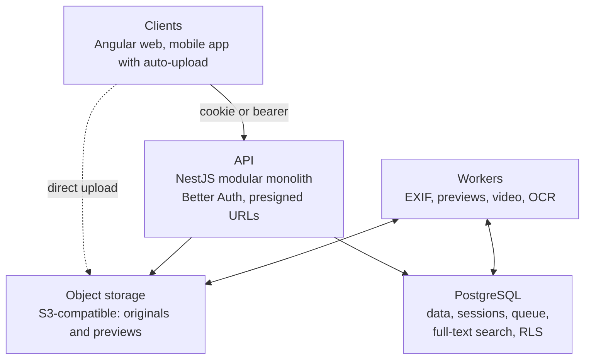

# Backend architecture

Created November 19, 2026; updated November 21, 2026 (Better Auth, API contract, languages, review outcomes).

**Product: Swarm Keeper** — a family archive for photos and documents (Angular web app plus a separate native mobile app).

Recommendation: a TypeScript modular monolith, separate workers for heavy processing, PostgreSQL for metadata and S3-compatible storage for the files themselves. Version 1 stores photos and documents with access for the whole family.

## Component diagram

Files bypass the API: clients upload them straight to storage.

Clients sign in through Better Auth inside the API (cookie on the web, bearer token in the mobile app) and upload files directly to storage. Workers take jobs from a queue in PostgreSQL and write previews back to storage.

## 1. Overall shape: modular monolith plus workers

One repository (pnpm workspaces) and one API process (NestJS on Express, TypeScript) with clear modules inside: `identity` (families, members, roles), `assets` (files), `albums`, `documents`, `search`, `audit`, `jobs`.

Each module owns its tables, and modules talk to each other only through service interfaces, never through each other's tables. The same code runs as a second process in worker mode. If a module ever needs to become its own service, the boundaries are already in place.

## 2. Storage: bytes separate from metadata

- **Files live only in S3-compatible storage** — never in the database and never on local disk at a hard-coded path. Put them behind a `BlobStorage` interface: MinIO or Garage in dev, any S3-compatible provider in production (Hetzner, Backblaze B2, Cloudflare R2), the local filesystem for tests.
- **Keys don't depend on file names:** `families/{familyId}/blobs/{blobId}/original`, next to it `.../thumb_256.webp`, `.../thumb_512.webp`, `.../preview_1440.webp`, `.../video_720.mp4`. The original file name is stored only in `asset` metadata.
- **Originals are immutable.** Rotation, cropping and date fixes are metadata on top of the original. Derived files (previews etc.) can be regenerated at any time.
- **Bytes separate from records.** A file is stored once per family in `blob` (unique on `(family_id, sha256)`), and `asset` is one owner's record pointing to a `blob`. SHA-256 gives deduplication, integrity checks and fast sync from mobile devices. The "already exists" check looks only at the user's own files and the family's shared files. If the same bytes exist only in someone else's private file, the client still uploads the file, and after `complete` the server links the new `asset` to the existing `blob` and deletes the copy: the API response never reveals that someone already has this file. A `blob` is deleted when no `asset` references it.

## 3. Upload

Files go from the client straight to storage via presigned URLs; the API only registers and finalizes the upload.

1. The client tells the API: "I want to upload a file; here are its size, MIME type and SHA-256."
2. The API answers "this file already exists" (among the user's own or the family's shared files) or issues a presigned URL. Large files use multipart upload: parts upload independently and resume after a dropped connection.
3. The client uploads the file **directly to storage**, so the API never streams gigabytes through itself.
4. The client calls `complete`. The API verifies the object, moves the asset to `processing` and enqueues jobs.

Design for mobile auto-upload from day one: an endpoint "here is a batch of hashes, which ones don't you have?" and a sync endpoint "everything that changed after cursor X".

## 4. Worker processing

- **Queue** — pg-boss, right inside PostgreSQL: one component fewer, and jobs are enqueued in the same transaction as the asset record. You can move to BullMQ with Redis later if performance requires it.
- **Pipeline:** EXIF and metadata (exiftool), 256, 512 and 1440 px previews (sharp/libvips), HEIC conversion, video (ffmpeg), OCR for documents (ocrmypdf/tesseract, languages rus+eng) and a first-page preview for PDFs. Derived files are computed once per `blob`.
- **Jobs are idempotent:** re-running one breaks nothing, and after a failure the state is visible in the asset status.
- ML (faces, CLIP semantic search) can later move to a separate Python service that takes jobs from the same queue.

## 5. Data model (core)

Every archive table carries `family_id` — the Better Auth `organization.id`. IDs are UUIDv7, defaulted in the database with PostgreSQL 18's `uuidv7()`.

Columns are snake_case in the database; code sees them as camelCase through Kysely's `CamelCasePlugin`.

| Table | Key fields | Purpose |
| --- | --- | --- |
| `user`, `session`, `account`, `organization`, `member`, `invitation` | Better Auth tables; `session.activeOrganizationId`, `member.role`; our fields `user.locale`, `user.uiSize`, `invitation.locale`, `invitation.uiSize` | Users, sessions, families (organizations), roles owner / admin / member / viewer, interface language and size |
| `person` | name, optional link to `user` | A family member, not necessarily a user (grandma, great-grandfather, a child); also useful for a future family tree |
| `blob` | `sha256`, `size`, `mime`, `width`, `height`, `duration` | File bytes, stored once per family; width and height drive the timeline layout |
| `blob_derivative` | type (`thumb_256`, `thumb_512`, `preview_1440`, `video_720`), storage key, `size`, dimensions | Previews and transcodes |
| `asset` | `owner_id`, `blob_id`, `kind` (photo / video / document), `original_name`, `taken_at_local`, `taken_at_offset`, `status`, `visibility` (private / family), `updated_at`, `deleted_at` | One owner's record of a file |
| `photo_meta` | camera, GPS, orientation | Photo metadata |
| `document_meta` | `type` (code from a fixed list: `passport`, `birth_certificate`…), number, issued by, expiry date, extracted text | Document metadata and OCR search; clients translate the type name |
| `album`, `album_asset`, `tag`, `asset_tag`, `asset_person` | many-to-many links | Albums, tags, people in photos and documents |
| `favorite` | `user_id`, `asset_id` | Personal favorites: each member has their own |
| `audit_event` | `family_id`, `actor_id`, `action`, `target_type`, `target_id`, `params`, `at` | Activity log: written from v1, the viewing screen comes later |
| `tombstone` | `family_id`, `entity`, `entity_id`, `deleted_at` | Permanent deletions, for native client sync |

Synced tables (`asset`, `album`, `album_asset`, `person`, `favorite`…) carry `updated_at`, and a permanent deletion leaves a row in `tombstone`. `taken_at_local` and `taken_at_offset` are stored separately because EXIF often has no time zone (section 7).

**Storage usage.** A family's usage is `sum(blob.size)` plus `sum(blob_derivative.size)` over its rows. Each stored object is counted once, so the figure matches what the bucket holds: deduplicated bytes, and items in the trash until they are purged. Derivatives are reported as a separate figure, since they can be regenerated. Both tables are indexed on `family_id`. A `SUM` query is enough for a few families; when quotas arrive, a per-family counter is kept in the same transaction as blob inserts and deletes.

## 6. Access and security

- **Authentication is the Better Auth library inside the API**, with no separate IdP. Its plugins provide passkeys, 2FA, invitations and roles; a family is an organization. The web app uses an httpOnly cookie, the mobile app a bearer token. Sign-up is by invitation only. Details: [authentication.md](authentication.md).
- **Authorization** lives in the service layer (roles from the organization plugin), plus `family_id` in every table and PostgreSQL Row-Level Security as a second line of defense against bugs.
- **Database roles.** RLS does nothing for a superuser or a `BYPASSRLS` role, so the API never connects as the schema owner:
  - The schema owner runs migrations and codegen (`DATABASE_OWNER_URL`). Migrations never create roles: on managed Postgres the owner usually lacks `CREATEROLE`.
  - The group role `swarm_keeper_app` (`NOLOGIN NOSUPERUSER NOBYPASSRLS`, owns nothing, no DDL) gets data access through grants in migrations: one migration for the tables that existed when it was written, and each later table grants for itself. There are no default privileges: they only cover tables created later by the same role.
  - The API, the worker and the CLI connect as a login role in that group (`DATABASE_URL`).
  - Setting up a server: as an admin run `pnpm db:roles` once per cluster (it creates the group), create the login with `create role <login> login password '…' in role swarm_keeper_app`, then run `pnpm db:migrate` as the owner. In development `pnpm infra:up` does this, with the login `swarm_app`.
- **Files are served via short-lived presigned GET URLs** or via an API proxy that supports Range requests (for video). There must be no direct public links to the bucket.
- **Trash:** soft delete (`deleted_at`); deleted items are kept for 30 days, then a job deletes them permanently — together with the `blob` if nothing else references it. In a family archive, accidental deletion is the most likely way to lose data.
- **A member leaving.** When someone leaves the family or is removed, their shared files stay with the family: they are still shown as the author, and admins and owners can edit and delete those files. Their private files are marked deleted and permanently removed after 30 days; if the person returns sooner, they are restored, and before leaving the person can export them. If the account is deleted entirely, `owner_id` is set to null and the author is shown as "former member".
- **Activity log.** Uploads, deletions, restores, metadata edits, invitations and role changes write an `audit_event` in the same transaction. A log screen for admins and owners comes later.

## 7. Decide now (expensive to change later)

1. **Encryption: server-side now, E2E later.** This is the main fork. With E2E the server can't build previews, run OCR or search; everything moves to the client and the architecture is completely different. Decided November 21, 2026: server-side encryption (SSE) plus encrypted backups; E2E later only for a separate "vault" category (passports and similar).
2. **Multi-tenancy via `family_id`** from day one: one installation serves several families, created by the operator (see [authentication.md](authentication.md), "Operator").
3. **UUIDv7** IDs: time-sortable and generated on the client for offline uploads.
4. **Capture time.** EXIF often lacks a time zone, so store local time and offset separately, not just a `timestamptz`.
5. **Open export format:** originals plus JSON or XMP sidecars with metadata. The archive must outlive the app.
6. **Backups:** PostgreSQL via pgBackRest (WAL + full), bucket replicated to another provider, and restores tested regularly.

## 8. Not at the start, and the final stack

Not needed at the start: microservices, Kubernetes, Elasticsearch (PostgreSQL full-text search and pg_trgm are enough, pgvector later), home-grown auth, GraphQL, ML. **Later, without rework:** links for people outside the family (`share_link`), contacts (built on `person`), document expiry reminders, the activity log screen. All of these can be added as long as the architecture above holds.

| Layer | Choice |
| --- | --- |
| API and workers | NestJS + TypeScript |
| Database access | Kysely (migrations with `kysely-ctl`, types generated with `kysely-codegen`) |
| Database | PostgreSQL |
| Queue | pg-boss |
| Files | S3-compatible storage |
| Processing | sharp, ffmpeg, exiftool, ocrmypdf |
| Authentication | Better Auth (passkeys, 2FA, organizations) |
| Proxy and deployment | Undecided (any reverse proxy that overwrites `x-forwarded-for`) |
| Client | Angular with a typed client generated from OpenAPI |
| Monorepo | pnpm workspaces |

## 9. API: the contract for web and native

There are two clients: the Angular web app and a separate native app with auto-upload. They share code only through the API, so the API is the project's main contract. The frontend is described in [frontend.md](frontend.md).

1. **Versioning.** All routes live under `/api/v1`. Within a version, only additive changes; anything incompatible goes to `/v2`. Native apps update through app stores with a delay, and old versions must keep working.
2. **OpenAPI as an artifact.** CI builds the spec from NestJS, publishes it and checks it with `oasdiff` for breaking changes. The Angular and native clients are generated from it.
3. **`GET /me`.** Returns the user (with `locale` and `uiSize`), their families, the active family, and their role and effective permissions in it. Both clients show buttons based on this list; the server still checks against the matrix in `libs/shared/permissions`.
4. **Upload protocol** (section 3) is defined in the API and identical for both clients. Each multipart part uploads independently so the native app can hand it to a system background task (background `URLSession`, WorkManager).
5. **Sync.** `GET /sync?cursor=…` returns changes after the cursor and a new cursor. Synced tables therefore have `updated_at` (or a monotonic change counter), and deletions leave tombstones. This goes into the schema from the start.
6. **Authentication.** Web — cookie, native — bearer token. For passkeys in the native app, the reverse proxy serves `/.well-known/apple-app-site-association` and `/.well-known/assetlinks.json`.
7. **Previews via stable URLs.** `GET /assets/:id/thumb?size=256|512` and `/preview` check permissions and respond with a 302 redirect to a short-lived presigned URL, so clients don't depend on URL expiry.
8. **Timeline summary.** `GET /timeline/summary` returns photo and video counts per month, so the year scrubber in the timeline is accurate before all pages load.

**Languages: English and Russian from day one.** Clients translate; the backend returns data and codes (see [i18n.md](i18n.md)).

- `user.locale` (`en` or `ru`) is stored in the profile and returned by `GET /me` together with `uiSize`. On first sign-in it comes from the invitation or `Accept-Language`.
- API errors are codes with parameters (`{"code": "upload.duplicate", "params": {"takenAt": "…"}}`), with no ready-made text. Dates are ISO 8601; the client formats them. A global filter enforces this on our routes: unexpected errors become `INTERNAL` (500) with details only in the log, plain 401 / 403 / 404 become `UNAUTHENTICATED` / `FORBIDDEN` / `NOT_FOUND`, and any other status without a code becomes `HTTP_<status>` (for example `HTTP_400` for malformed JSON). Better Auth's `/api/auth/*` responses keep its `{ code, message }` shape; clients read only `code`.
- Emails (invitation, email verification, password reset) have `en` and `ru` templates; the invitation goes out in `invitation.locale`, everything else in `user.locale`.
- OCR runs with the `rus+eng` languages.
- Full-text search: extracted text and captions get `tsvector` columns for both the `russian` and `english` configurations (generated columns + GIN indexes), and queries search both. Names and exact matches use `pg_trgm`.
- User data (titles, captions, names) is stored as entered and never translated.
