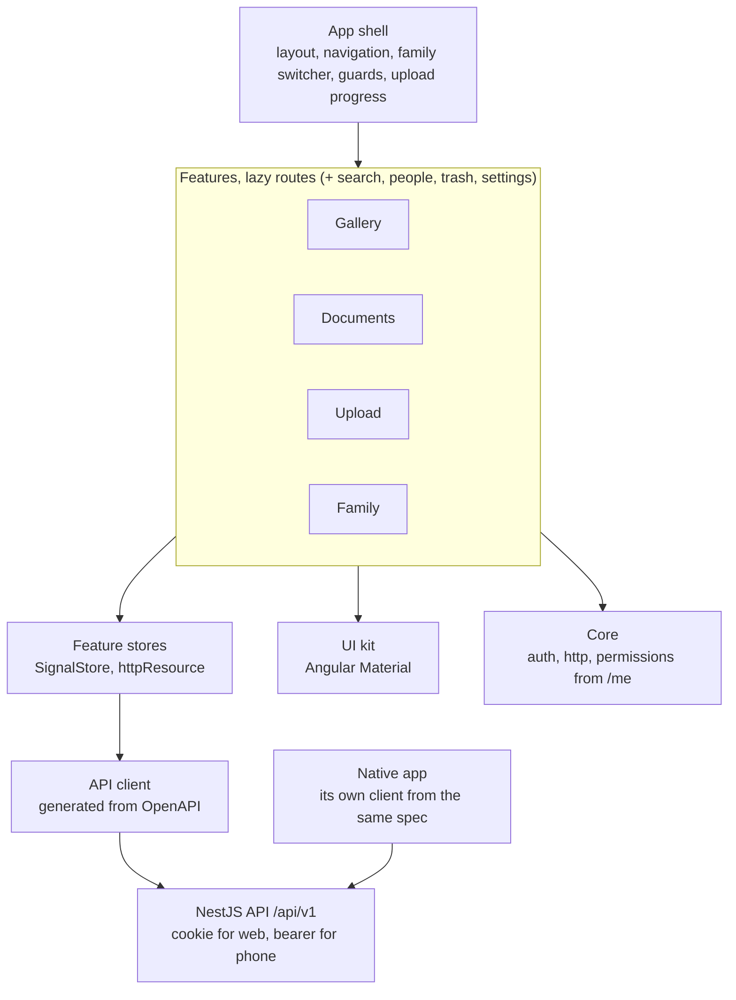

# Frontend architecture

November 21, 2026.

**Product: Swarm Keeper** — a family archive for photos and documents.

## Decision and foundation

The web client is Angular 22, built entirely on signals, with lazy-loaded features and shared libraries. The mobile app is a separate native app; it shares only the API with the web.

- **Angular 22.** Signal Forms, `resource` and `httpResource` are stable, OnPush is the default strategy, and the HTTP client uses Fetch. Angular 23 is planned for June 2027 (the move to a yearly cycle), so no major migrations until then.
- **Rules:** standalone components only, no zone.js, OnPush; state in signals; RxJS only for real streams (the upload queue); forms with Signal Forms.
- **No SSR.** The whole app sits behind sign-in; no SEO needed.
- **The mobile app is separate.** Phone auto-upload lives there. The web can freely use browser APIs (IndexedDB, Web Workers, File System Access) without Capacitor shims.
- **PWA without offline.** A manifest and icons (`swarm-keeper-app-icon`) so the web app can be added to the home screen. `ng add @angular/pwa`; the service worker caches only the app shell and offers to update when a new version ships. Data and previews are not cached: offline belongs to the native app.

## Layer diagram

Features load lazily; only the API is shared with the native app.



Dependencies point downward only: features don't know about each other, and the native app shares only the OpenAPI spec and the API itself with the web.

## Repository structure and boundaries

The backend and the web app live in one monorepo (pnpm workspaces) so the API client and the permission matrix can't drift apart. The native app can live in a separate repository: its link to us is the published OpenAPI spec.

```
apps/
  api/                 NestJS
  worker/
  web/                 Angular
libs/
  shared/permissions/  ac, roles — shared by api and web
  web/api-client/      generated client
  web/core/            auth, http, config, error handling
  web/ui/              UI kit: buttons, dialogs, tiles, viewer
  web/features/
    gallery/           timeline, albums, photo viewer
    documents/
    upload/
    family/            members, invitations, roles
    people/  search/  trash/  settings/
```

Boundary rules:

- Each feature has three layers: `data-access` (store and API calls), `feature` (pages), `ui` (components with no store dependencies).
- Features don't import each other; shared code goes to `ui` or `core`.
- Boundaries are enforced by Sheriff.
- `web/api-client` is generated from the NestJS OpenAPI spec (e.g. `@hey-api/openapi-ts`); no hand-written DTOs, and CI fails if the client is stale.

## Data and state

There is no global NgRx Store: simple reads use `httpResource`, complex state lives in a SignalStore per feature.

| Case | Tool | Examples |
| --- | --- | --- |
| Reading one entity or a short list | `httpResource` in a component or store | Document card, member list, album |
| Large lists, selection, optimistic updates | NgRx SignalStore per feature | Timeline with cursor pagination, multi-select of photos, trash |
| Long-running background processes | App-level service + RxJS + IndexedDB | Upload queue |
| Session, active family, permissions | Signals in `AuthService` (core) | Header, guards, permission directive |
| Forms | Signal Forms | Invitation, editing document metadata |

Switching the active family resets every feature store and refetches `GET /me`. Stores are provided at the feature route level (`providers` in the lazy route), not in `root`, so leaving a page frees memory.

## Authentication and permissions on the web

The web app uses Better Auth's httpOnly cookie on the same domain as the API, and takes its UI permission list from `GET /me` — just like the native app.

- **`AuthService` (core)** wraps `createAuthClient` from `better-auth/client` and holds the `session`, `activeFamily` and `permissions` signals.
- **`canMatch` guards:** `authGuard` (has a session), `familyGuard` (a family is selected), `permissionGuard('member', 'create')` for admin pages.
- **The `*appCan="['asset', 'delete']"` directive** hides buttons based on the permission list from `/me`. For "own" items (editing your own photo) it also takes an `ownerId`.
- **HTTP interceptor:** on 401 it goes to `/login` and remembers where the user was heading; 403 shows a clear message rather than a "server error"; the `TWO_FACTOR_REQUIRED` code leads to `/settings/security` for 2FA setup.

| Route | What's there | Access |
| --- | --- | --- |
| `/login` | Passkey, password, 2FA | Everyone |
| `/invite/:token` | Create an account from an invitation; the link also verifies the email | Via link |
| `/` and `/photos/:id` | Timeline and the viewer on top of it | Family members |
| `/albums`, `/albums/:id` | Albums | Family members |
| `/documents`, `/documents/:id` | Documents with previews and metadata | Family members |
| `/people/:id` | A person's photos and documents | Family members |
| `/search` | Search by metadata and OCR | Family members |
| `/upload` | Upload queue | member and above |
| `/trash` | Trash | member and above; emptying — admin |
| `/family/members` | Members, invitations, roles | admin and owner |
| `/settings/security` | Passkeys, 2FA, active sessions | Signed-in user |
| `/settings/appearance` | Interface language and size | Signed-in user |
| `/favorites` | Personal favorites | Family members |

## Gallery and viewer

The gallery's main risk is performance with tens of thousands of photos, so only what's visible is rendered, and image URLs don't depend on presigned URL lifetimes.

- **Justified layout with virtual scrolling.** The standard CDK virtual scroll assumes equal row heights, so we need a custom strategy: the layout is computed from aspect ratios (width and height come with every file), and only visible rows plus a buffer are rendered.
- **Grouping by date and a year scrubber.** The API returns a compact timeline "map" (month → photo count, `GET /timeline/summary`) so the scrollbar is correct before all pages load.
- **Images:** ``. The API checks the cookie and responds with a 302 redirect to a short-lived presigned URL. HTML doesn't depend on URL expiry, and the browser caches previews. `loading="lazy"` and `srcset` from the 256 and 512 px previews (`size` parameter): high-density screens and large mode use 512.
- **The viewer** is a child route `/photos/:id` on top of the timeline: the link can be shared with a relative, Back works naturally, and the timeline position is preserved. Arrow keys and swipes, preloading of neighboring photos, video via HTML5 `<video>` with Range requests.
- **Documents:** first-page preview from the worker, full PDF viewing via pdf.js, search over extracted OCR text with highlighting.

## Uploading from a computer

On the web, uploads cover manual scenarios: folders of old photos, document scans, large video archives. Phone auto-upload lives in the native app and uses the same API protocol.

1. **Picking files:** drag and drop, file picker or a whole folder (File System Access API where available, otherwise `webkitdirectory`).
2. **Hashes:** SHA-256 is computed in a Web Worker as a stream (e.g. `hash-wasm`), so a 4 GB video doesn't freeze the tab.
3. **Dedup:** a batch of hashes goes to the server; files that already exist among the user's own or the family's shared files are dropped before upload.
4. **Transfer:** multipart via presigned URLs, 3–4 parallel parts per file, 2–3 files at once, retries with exponential backoff.
5. **Completion:** `complete`, then the file stays in `processing` while workers build previews.

Queue state (file, hash, `uploadId`, finished parts) is stored in IndexedDB. After the tab closes, the upload resumes where it stopped: the user only has to pick the file again, and with the File System Access API it's enough to confirm access to the saved file. The queue lives in an app-level service, navigation doesn't interrupt it, and progress shows in the header.

## Contract with the native app

The web and native apps share no code, only the API. So everything that must behave the same is defined in the API, not in web code.

| What's shared | How it's ensured |
| --- | --- |
| Types and endpoints | The OpenAPI spec is published from CI; the Angular and native clients are generated from it |
| Version compatibility | `/api/v1`, additive changes only; `oasdiff` in CI catches breaking ones. Native apps update with a delay |
| UI permissions | `GET /me` returns the role and permission list in the active family; both clients show buttons by it |
| Upload protocol | SHA-256 → batch hash check → multipart via presigned URLs → `complete`; on iOS parts go to background `URLSession` tasks, on Android via WorkManager |
| Sync | A "changes after cursor" endpoint with tombstones for deletions; needed by the native cache |
| Authentication | Web — cookie, native — bearer; for passkeys in the native app the domain serves `/.well-known/apple-app-site-association` and `/.well-known/assetlinks.json` |

The native app's stack (Swift + Kotlin, Kotlin Multiplatform or Flutter) doesn't affect the web or the API and can be chosen later.

## Interface languages

The interface ships in two languages from day one: English and Russian. Language is a personal member setting, like the size mode: stored in the profile and switched without a reload.

- **Transloco, not Angular's built-in i18n.** The built-in one produces a separate build per language and switches only with a reload. Transloco uses one build, with translations as per-feature JSON files (`i18n/<feature>/en.json`, `ru.json`) loaded lazily with the feature.
- **Per-feature keys**, with English as the key and fallback language: `gallery.empty.title`, `upload.status.duplicate`. Templates contain no literal text. transloco-keys-manager in CI catches missing and unused keys; the build fails if a key is missing from `en` or `ru`.
- **Plurals use ICU MessageFormat** (the messageformat plugin for Transloco). Russian has `one`, `few`, `many`; English has `one`, `other`.
- **Dates, numbers, file sizes, durations** go only through `Intl` with the user's locale: "12 июля 2025" / "July 12, 2025", "3,4 МБ" / "3.4 MB". `en` and `ru` locale data are registered; shared `fileSize` and `duration` pipes live in `libs/web/ui`. Material's `DateAdapter` switches locale together with the language.
- **Where the language comes from:** after sign-in — `locale` from `GET /me`; before sign-in (`/login`, `/invite/:token`) — `navigator.languages`, otherwise English; on the invitation page — the invitation's language. It's switched in "Settings → Appearance", next to the interface size. The `lang` attribute on `<html>` changes with the language.
- **API errors** arrive as codes with parameters (`upload.duplicate`, `invite.expired`); text comes from the `errors.<code>` key. Better Auth codes (`INVALID_EMAIL_OR_PASSWORD` etc.) and our auth codes (`INVITE_REQUIRED`, `TWO_FACTOR_REQUIRED`) are translated via `errors.auth.<code>` keys; document types via `documents.type.<code>`.
- **Not translated:** whatever people typed — album titles, captions, names, document metadata.
- **No fixed widths in layouts:** Russian strings are usually 20–30% longer than English. Playwright runs key screens in both languages.

A plural example in the translation files:

```json
// i18n/upload/en.json
{ "summary": "{count, plural, one {# file uploaded} other {# files uploaded}}" }

// i18n/upload/ru.json
{ "summary": "{count, plural, one {Загружен # файл} few {Загружено # файла} many {Загружено # файлов} other {Загружено # файла}}" }
```

The native app uses its own translation system and the shared glossary from the design system. Web translations are stored as JSON files in the repository; no separate translation service (Tolgee, Weblate) is needed.

## UI kit, accessibility, tests

- **UI kit — Angular Material (M3).** The fast path to a ready, accessible interface. For a family archive, predictability and accessibility matter more than a unique style. Angular Aria (stable in 22) is the alternative if we ever need a fully custom design.
- **Accessibility from day one:** compact mode by default and large mode by each member's choice, contrast, keyboard navigation, labels on icons. People of all ages will use the interface.
- **Languages:** English and Russian from day one; see "Interface languages".
- **Unit tests — Vitest:** stores, the permission directive, the gallery layout, the upload queue.
- **End-to-end tests — Playwright:** sign-in via invitation, upload with dedup and resume, a viewer doesn't see the Upload button, another family is inaccessible. They run against the real API in Docker Compose.

## Open questions

- [ ] The native app's stack.

## Sources

- [What's new in Angular 22.0 (Ninja Squad)](https://blog.ninja-squad.com/2026/06/03/what-is-new-angular-22.0)
- [Angular v22: Signal Forms, resources, Angular Aria (InfoQ)](https://infoq.com/news/2026/08/angular-v22-released)
- [Angular's new yearly release cycle, v23 in June 2027 (angular.love)](https://angular.love/angular-new-release-cycle-release-schedule-change-explained)
- [Angular 22: OnPush by default, Resource API, Aria (JavaScript Conference)](https://javascript-conference.com/blog/angular-22-new-features-onpush-resource-api/)
